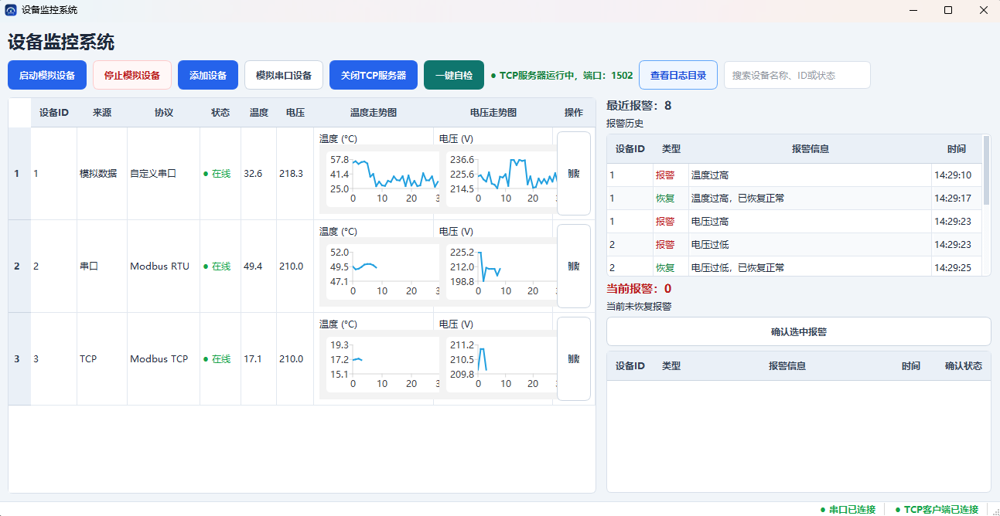
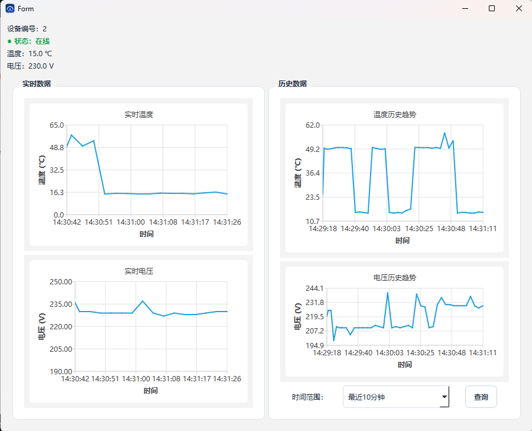
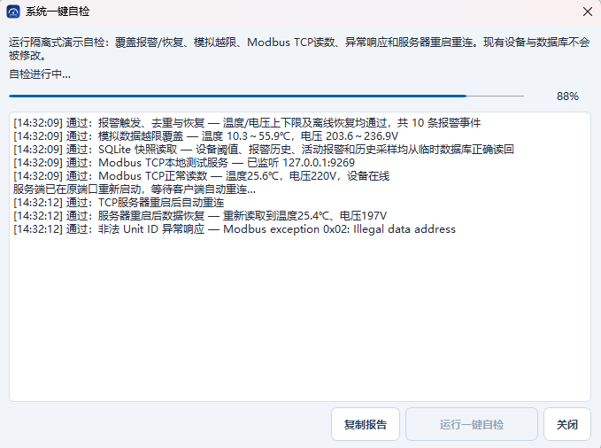
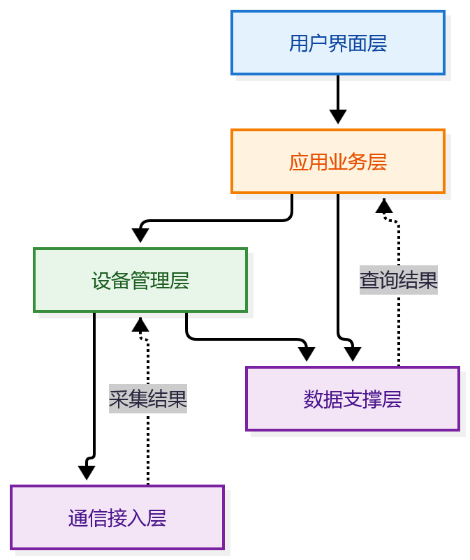

# 设备监控上位机系统

基于 Qt/C++ 的多设备采集、报警与历史追溯工具。

[](#开发与测试)
[](#许可证与致谢)
[](#环境要求)
[](#环境要求)

## 功能特性

- 管理多个设备配置、连接状态和采集数据。
- 接入自定义串口协议、Modbus RTU 与 Modbus TCP。
- 查看设备在线状态、温度、电压和实时趋势。
- 添加设备时设置温度、电压报警上下限，查看、确认和追溯报警。
- 将设备配置、采样记录和报警历史保存到 SQLite。
- 按时间范围查询历史采样并查看趋势曲线。
- 启动内置模拟设备或 TCP 模拟服务，验证界面与采集流程。
- 运行隔离式一键自检，检查报警、存储、Modbus TCP 和重连流程。

## 界面截图




主界面截图：展示设备列表、在线状态、实时读数和报警概览。




设备详情截图：展示温度、电压曲线以及历史数据查询区域。




自检截图：展示检查进度、通过/失败结果和诊断日志。

## 快速开始

### 环境要求

| 组件 | 版本或模块 |
| --- | --- |
| Qt | 构建基线为已验证的 Qt 6.8.1；需要 Core、Widgets、Sql、Charts、SerialPort、Network、Concurrent。CMake 声明查找 Qt 5/6，但只验证过 Qt 6.8.1 |
| 编译器 | C++17；已验证配置为 MinGW 13.1.0 64-bit |
| CMake | 3.16 或更高版本 |
| 生成器 / 数据库 | MinGW Makefiles；Qt SQL 的 SQLite 驱动（QSQLITE） |
| 平台 | 当前验证环境为 Windows + MinGW 64-bit；其他平台未验证 |

### 构建步骤

安装 Qt 对应的 MinGW kit 和 CMake，并将 MinGW 的 `bin` 目录加入 `PATH`。以下命令显式选择 `MinGW Makefiles` 生成器，以 Qt 安装在 `C:/Qt` 为例；安装位置不同时替换 Qt 路径。

```bash
git clone https://github.com/Chick9N/MonitoringSystem.git
cd MonitoringSystem
cmake -S . -B build -G "MinGW Makefiles" -DCMAKE_PREFIX_PATH="C:/Qt/6.8.1/mingw_64" -DCMAKE_BUILD_TYPE=Debug
cmake --build build
```

也可在 Qt Creator 中打开 `CMakeLists.txt`，选择 Qt 6.8.1 MinGW 64-bit Kit 后构建。

### 运行步骤

```powershell
$env:PATH = "C:/Qt/6.8.1/mingw_64/bin;C:/Qt/Tools/mingw1310_64/bin;$env:PATH"
.\build\MonitoringSystem.exe
```

CMD 中可使用：

```cmd
set "PATH=C:\Qt\6.8.1\mingw_64\bin;C:\Qt\Tools\mingw1310_64\bin;%PATH%"
build\MonitoringSystem.exe
```

上述 `PATH` 按 Qt 默认安装目录示例填写；安装位置不同时替换为对应 Qt 和 MinGW 的 `bin` 目录。若使用多配置生成器，程序通常位于 `build\Debug\MonitoringSystem.exe`。主窗口启动后，点击“启动模拟设备”即可看到内部模拟数据；设备列表和实时曲线开始更新后，表示基本运行链路已就绪。

## 使用指南

### 添加设备与配置通信

点击“添加设备”，选择协议并填写设备名称、通信参数和寄存器范围，再点击确认。收到有效响应后，设备在列表中显示在线及读数。

| 协议 | 配置项 |
| --- | --- |
| 自定义串口 | 串口、波特率、数据位、校验位、停止位 |
| Modbus RTU | 串口参数、从站地址、起始寄存器、数量 |
| Modbus TCP | IP、端口、Unit ID、起始寄存器、数量 |

本机演示 Modbus TCP 时，先点击“启动 TCP 模拟服务”，再添加地址 `127.0.0.1`、端口 `1502`、Unit ID `1`、`2` 或 `3` 的 Modbus TCP 设备。串口模拟需准备虚拟串口对：模拟器与上位机分别选择配对的两端。

### 配置报警阈值

在“添加设备”窗口设置温度和电压上下限，且上限必须大于下限。阈值在添加时配置。有效采样越限后，界面显示并记录报警事件。

### 查看实时数据与趋势

在设备列表中查看在线状态、温度、电压和迷你趋势；双击设备行打开详情窗口。预期可看到实时曲线以及独立的历史趋势区域。

### 查看与确认报警

在主窗口的当前报警表中选择一条报警，点击“确认选中报警”。确认状态会更新并写入数据库；恢复后的事件保留在报警历史中。

### 查询历史数据

打开设备详情，在历史数据区域选择时间范围（最近 1 分钟、10 分钟、1 小时或 24 小时），点击“查询”。查询完成后显示该设备的历史温度、电压曲线。

### 执行一键自检

点击主窗口“一键自检”运行隔离检查，或按[开发与测试](#开发与测试)中的命令行方式执行。报告显示各检查项结果；该流程使用临时 SQLite 文件和本地临时 TCP 端口，不修改正式设备与应用数据库。

## 项目架构



用户界面层展示数据并接收操作。应用业务层组织采集、报警和查询流程。设备管理层维护设备配置、运行状态及数据分发。通信接入层处理串口和 TCP 协议交互。数据支撑层负责 SQLite 读写、启动快照和历史查询。

## 技术亮点

- 将 UI 保持在主线程，Modbus TCP 使用工作线程，数据库查询和采样写入走异步路径。
- 使用 `DatabaseWriteQueue` 串行处理采样和报警写入，降低并发写库冲突。
- 通过统一设备数据接口隔离协议收发与界面展示，支持自定义串口、Modbus RTU 和 Modbus TCP。
- 对持续越限报警去重，并将确认、恢复状态与报警历史关联。
- 使用独立 SQLite 连接读取启动快照和历史数据，设备配置写入失败时回滚。
- 一键自检使用临时数据库和系统分配的 TCP 端口，避免影响正式数据。
- 详细方案见[关键问题解决方案（Markdown）](docs/关键问题解决方案.md)，也可下载[Word 原文](docs/关键问题解决方案.docx)。

## 目录结构

```text
.
├── Communication/  # 串口、Modbus、协议解析与模拟服务
├── Core/           # 设备、设备管理、数据模型与报警管理
├── Data/           # SQLite 数据访问与异步写队列
├── UI/             # 主窗口、设备详情、配置和自检界面
├── Utils/          # 日志、模拟数据和界面辅助组件
├── Resources/      # 应用图标等资源
├── docs/
│   ├── pics/       # 需求与设计图示
│   └── screenshots/ # README 界面截图（待补充）
├── CMakeLists.txt  # CMake 构建和 CTest 配置
└── main.cpp        # 应用入口及命令行自检入口
```

## 开发与测试

配置并构建后运行 CTest；当前注册的测试项会启动同一套隔离式一键自检：

```bash
ctest --test-dir build --output-on-failure
```

也可直接运行自检程序。在 Windows PowerShell 中：

```powershell
$env:QT_QPA_PLATFORM = 'offscreen'
.\build\MonitoringSystem.exe --self-test
if ($LASTEXITCODE -ne 0) { throw '自检失败' }
```

自检覆盖报警触发/去重/恢复、模拟越限、SQLite 快照、Modbus TCP 读数、异常响应、服务端重启后的自动重连及停止重连。串口收发依赖虚拟串口对或真实硬件，需单独验证。当前 CMake 未配置独立单元测试目标；自检通过不代表现场通信或完整 UI 回归已通过。

正常完成时，控制台摘要为 `系统自检完成：通过 9 失败 0`，进程退出码为 `0`。自检通过后仍需在目标设备上验证实际串口和端到端通信。

## 常见问题（FAQ）

**串口打不开怎么办？** 检查端口是否存在、参数是否与设备一致，并关闭占用该端口的终端或其他程序。虚拟串口测试时，模拟器和上位机必须选择配对的不同端口。

**Modbus TCP 连不上怎么办？** 核对设备 IP、端口和防火墙；本机模拟时先启动 TCP 模拟服务，并使用 `127.0.0.1:1502` 与 Unit ID `1`～`3`。

**启动模拟设备后没有数据怎么办？** 确认已点击“启动模拟设备”，设备行显示在线；TCP 演示还需添加指向本地模拟服务的 Modbus TCP 设备。

**数据库写入失败怎么办？** 检查磁盘空间和当前工作目录写权限，确认数据库文件未被其他程序锁定，再查看日志中的 SQLite 错误。

**数据库和日志文件在哪里？** 数据库文件名为 `device.db`，位于进程当前工作目录；从 Qt Creator、命令行或资源管理器启动时，工作目录可能不同。点击主窗口“查看日志目录”可打开日志位置，主日志文件名为 `monitoring.log`。

**历史查询没有结果怎么办？** 确认设备在所选时间范围内产生过在线采样，并扩大时间范围后重新查询。

**自检中的串口项在哪里？** 自检不占用现场串口；串口模拟请配置虚拟串口对并在“模拟串口设备”窗口单独启动验证。

## 贡献指南

提 Issue 时附上操作系统、Qt/CMake/编译器版本、复现步骤和脱敏日志。提交 PR 时说明改动范围、验证方式及已知影响；涉及协议行为时附请求/响应样例。

代码使用 C++17，沿用 Qt 对象所有权、信号槽和现有命名习惯；避免无关格式化改动。提交信息采用 Conventional Commits 风格，例如 `feat: add device status filter`、`fix: handle late TCP response`、`docs: clarify build steps`。

## 许可证与致谢

仓库当前未包含 `LICENSE` 文件，项目许可证尚未声明。复用或分发前请先确认权利人授权，并在仓库补充明确的许可证文件。

感谢 Qt、SQLite、CMake 及其维护者提供的开发框架、存储引擎和构建工具；第三方组件的版权与许可声明以各自项目发布内容为准。
